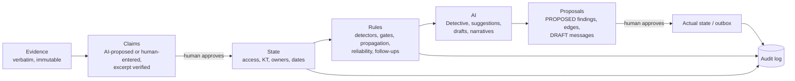
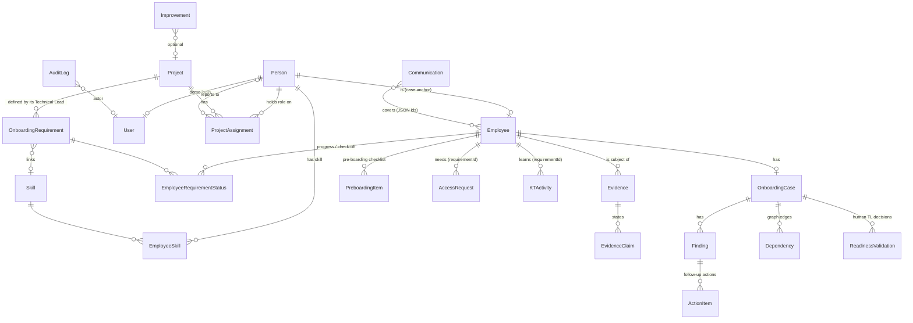

# Architecture

OnboardIQ is a modular monolith: Next.js 16 App Router (server components and server actions), Prisma 6 on SQLite, and a local Ollama model. Business logic lives in server modules under `src/modules`. React components only render and call server actions.

## One pipeline



1. **Evidence** is stored verbatim (`Evidence.content` is never updated). Tracker rows are evidence too (`TRACKER-<case>`), so even "no project recorded" cites a verbatim line.
2. **Claims** (`EvidenceClaim`) are structured statements with a verbatim excerpt. AI claims start PENDING.
3. **State** changes only when a human approves a claim. The change goes through the whitelisted field mapper (`src/modules/evidence/fieldMapper.ts`), which has no path to readiness validation.
4. **Rules**: `recomputeCase(employeeId, trigger, actor)` is the only writer of rule findings and readiness snapshots. It runs after approved mutations and from **Re-run analysis**. Pages only read: they evaluate the same pure functions over the loaded state.
5. **AI** runs only on explicit user actions. Its output is a *proposal* with verified evidence, logged in `AIRun`.
6. **Humans decide**: accept/resolve findings, confirm edges, approve and send messages, and (Technical Lead only) validate readiness.
7. **Audit**: every approval, rejection, edit, simulated send, status change, recompute and AI run is recorded with actor, before/after and evidence IDs. It is visible in each case's **History** tab.

### The case state and pure engines

`loadCaseState(employeeId)` (`src/modules/case/loadCaseState.ts`) builds one typed, Prisma-free `CaseState` (`src/domain/types.ts`). Everything deterministic is a pure function over it:

| Function | Purpose |
|---|---|
| `computeGates(state)` | the ten readiness gates |
| `evaluateReadiness(state, overrides?)` | gates → dependency graph → assessed level (used by pages, recompute **and** the simulator) |
| `runDetectors(state)` | candidate findings |
| `buildGraph / propagate` | blocking, downstream impact, minimal prerequisite set, topological order |
| `classifyCaseStatus / classifyAccess / classifyKT` | reliability |
| `buildFollowUps(cases, …)` | follow-up queue |
| `selectBriefing(role, …)` | briefing facts |

The simulator applies overrides to `structuredClone(state)` and calls exactly `evaluateReadiness`. That makes "what-if" and "actual" the same code path, and the simulator cannot write.

## Three information states

| State | Meaning | Visual |
|---|---|---|
| **Actual** | approved and stored; also deterministic computations over approved data (gates, assessed level, rule findings) | solid green "Actual" badge |
| **Proposed** | AI- or rule-generated, awaiting a human: AI findings, template/AI edges, template KT activities, pending claims, pending evidence, DRAFT messages, AI reviews | dashed amber "Proposed" badge and dashed borders |
| **Simulated** | hypothetical or synthetic: simulator results, simulated outbox messages and responses, demo templates | striped purple "Simulated" badge; the simulator shows a persistent striped banner |

`ProvenanceBadge` and `FactOrAssumption` (`src/components/ui/badges.tsx`) are the single shared markers.

## Data model



Key columns:

| Model | Columns |
|---|---|
| `User` | `role` = primary persona (PMO / HR / ADDITIONAL_MANAGER / LINE_MANAGER / TECH_LEAD / EMPLOYEE); `personId`, `employeeId` |
| `Person` | `role` (primary or organisation role), `isSimulated` (sample person, shown with a "Sample data" tag) |
| `ProjectAssignment` | `projectId`, `personId`, `role` (ADDITIONAL_MANAGER / LINE_MANAGER / TECH_LEAD / EMPLOYEE), `reportsToPersonId`, `assignedById/At`, `startDate`, `endDate`, `status` (ACTIVE / COMPLETED / REMOVED), `endReason`, `movement`, `isSimulated`. Never hard-deleted. |
| `OnboardingCase` | `phase` (PRE_BOARDING / ONBOARDING / READY / CLOSED), `phaseChangedAt/By`, readiness snapshot columns |
| `PreboardingItem` | `category`, `ownerRole` (HR / LINE_MANAGER), `status` (TODO / IN_PROGRESS / DONE / BLOCKED / NOT_APPLICABLE), `blockerReason`, `dueDate`, `evidenceId`, `updatedBy/At` |
| `Skill`, `EmployeeSkill` | catalogue; per-person `level`, `source` (SELF_DECLARED / TL_CONFIRMED / PREVIOUS_PROJECT / ASSESSMENT), `status` (CLAIMED / CONFIRMED / REJECTED), `confirmedById/At` |
| `OnboardingRequirement` | `type` (SKILL / KT_ACTIVITY / ACCESS / DOCUMENT), `skillId`, `requiredLevel`, `completionCriteria`, `mandatory`, `status` (ACTIVE / RETIRED) |
| `EmployeeRequirementStatus` | `status` (TODO / IN_PROGRESS / DONE / SATISFIED_BY_EXISTING_SKILL / WAIVED), `satisfiedBySkillId`, `checkoffUndone`, `decidedById/At`, `note` |
| `Improvement` | `projectId?`, `source` (INSIGHT / BRIEFING / MANUAL), `refs`, `ownerPersonId`, `status` (PROPOSED / APPROVED / IN_PROGRESS / DONE / DROPPED), `outcomeNote` |
| `Briefing` | `role`, `scopeKey` (ALL or project:id), `generatedById` |
| `AccessRequest` | `status` ∈ NOT_REQUESTED…USABLE, `usableConfirmedAt`, `handlerRole`, `owner`, `requirementId` (credentials are never stored) |
| `KTActivity` | `stage`, `stageBasis`, `scopeType`, `status`, `requiredApps`, `requirementId` |
| `Finding` | `origin` (RULE / AI), `category`, `fingerprint`, `facts`, `assumptions`, `rootCauses`, `recommendedActions`, resolution fields |
| `AIRun` | `agent`, `promptVersion`, `model`, `inputHash`, `inputRefs` (IDs only), `output`, `status`, `durationMs` |

All schema changes are Prisma migrations: `init`, `decision_support_foundation`, `followup_communications`, `management_briefing`, `adaptive_roadmap`, `org_model_assignments_phases` (also migrates MANAGEMENT → ADDITIONAL_MANAGER), `briefing_scope`, `preboarding_checklist`, `skills_requirements`, `improvements`.

### Permissions and scope

`src/modules/permissions.ts` resolves a **scope** per request (`resolveScope`): the user's project roles from ACTIVE assignments, every visible case with the user's relations to it (PMO, HR, AM, LM, TL, SELF) and its phase, and visible people. `can(scope, permission, context)` is pure and tested. Pages call `getScope()` (cached per request); modules call `assertAllowed(principal, permission, context)` before writing.

### Writers that only humans trigger

`modules/phase/transition.ts` (the only writer of `phase`), `modules/projects/service.ts` (projects, assignments, Technical Lead), `modules/preboarding/service.ts` (checklist, hand-over), `modules/requirements/*` (requirements, deterministic check-off), `modules/skills/service.ts`, `modules/improvements/service.ts`, `modules/validation/recordValidation.ts`. A test fails if any file under `src/ai` imports them.

## AI privacy design

- The provider refuses any `OLLAMA_BASE_URL` that is not `http://localhost`, `127.0.0.1` or `::1`, and refuses embedded credentials. Employee data cannot be sent to a cloud API by configuration mistake. A unit test covers this.
- Prompts contain only the relevant case's records and IDs, never the whole database.
- `AIRun.inputRefs` stores IDs only, not data dumps.
- There is no runtime mock: when the model is down, the UI says so and deterministic results remain.

## Request handling

- Server actions (`src/server/actions/*.ts`) are thin. Each one Zod-validates input, resolves the demo principal from an HTTP-only cookie, calls a module that checks `assertAllowed(principal, permission, context)` against the resolved scope, then `revalidatePath`.
- Route handlers: `/api/assistant`, `/api/session/role`, `/api/briefing/[id]/markdown`, `/api/search` (global search, scoped) and `/api/evidence/[id]` (verbatim source preview for source chips, scoped).
- Prisma queries are parameterised. SQLite JSON-in-string columns are parsed defensively (`src/lib/json.ts`).

## Folder map

```
src/domain        pure types, authority matrix, claim-field whitelist
src/modules       permissions (scope), case, readiness, detective, dependencies, simulator, reliability,
                  evidence, followups, briefing, validation, phase, projects (health, queries, service),
                  preboarding, requirements (check-off), skills, improvements, people, home, audit
src/ai            provider (loopback Ollama), runAgent (AIRun log + cache), verify (excerpts), prompts/*
src/server        principal/scope, app shell data, server actions
src/app           role homes (portfolio, my-projects, my-team, onboarding, preboarding, my-onboarding),
                  projects, people, requirements, team, escalations, case hub, investigations,
                  follow-ups, evidence, briefing, insights, knowledge, assistant, ai-activity
src/components    ui/ (design system: primitives, overlays, toasts, provenance chips), layout/ (sidebar,
                  top bar), feature components
src/lib           labels (every user-facing enum label), clock, auth, db
src/config        thresholds, navigation, case tabs, pre-boarding template, simulated templates
```
