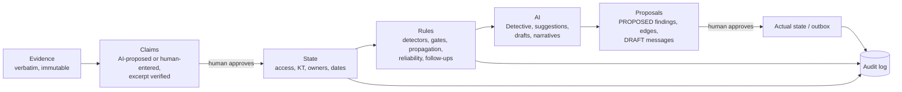
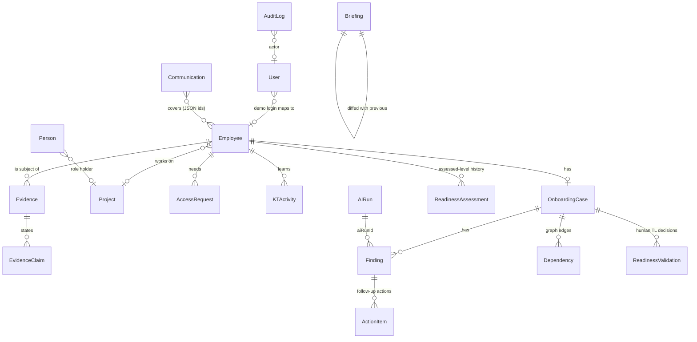

# Architecture

OnboardIQ is a modular monolith: Next.js 16 App Router (server components and server actions), Prisma 6 on SQLite, and a local Ollama model. Business logic lives in server modules under `src/modules`. React components only render and call server actions.

## One pipeline



1. **Evidence** is stored verbatim (`Evidence.content` is never updated). Tracker rows are evidence too (`TRACKER-<case>`), so even "no project recorded" cites a verbatim line.
2. **Claims** (`EvidenceClaim`) are structured statements with a verbatim excerpt. AI claims start PENDING.
3. **State** changes only when a human approves a claim. The change goes through the whitelisted field mapper (`src/modules/evidence/fieldMapper.ts`), which has no path to readiness validation.
4. **Rules**: `recomputeCase(employeeId, trigger, actor)` is the only writer of rule findings and readiness snapshots. It runs after approved mutations and from **Re-run analysis**. Pages only read: they evaluate the same pure functions over the loaded state.
5. **AI** runs only on explicit user actions. Its output is a *proposal* with verified evidence, logged in `AIRun`.
6. **Humans decide**: accept/resolve findings, confirm edges, approve and send messages, and (Technical Lead only) validate readiness.
7. **Audit**: every approval, rejection, edit, simulated send, status change, recompute and AI run is recorded with actor, before/after and evidence IDs. It is visible in each case's **History** tab.

### The case state and pure engines

`loadCaseState(employeeId)` (`src/modules/case/loadCaseState.ts`) builds one typed, Prisma-free `CaseState` (`src/domain/types.ts`). Everything deterministic is a pure function over it:

| Function | Purpose |
|---|---|
| `computeGates(state)` | the ten readiness gates |
| `evaluateReadiness(state, overrides?)` | gates → dependency graph → assessed level (used by pages, recompute **and** the simulator) |
| `runDetectors(state)` | candidate findings |
| `buildGraph / propagate` | blocking, downstream impact, minimal prerequisite set, topological order |
| `classifyCaseStatus / classifyAccess / classifyKT` | reliability |
| `buildFollowUps(cases, …)` | follow-up queue |
| `selectBriefing(role, …)` | briefing facts |

The simulator applies overrides to `structuredClone(state)` and calls exactly `evaluateReadiness`. That makes "what-if" and "actual" the same code path, and the simulator cannot write.

## Three information states

| State | Meaning | Visual |
|---|---|---|
| **Actual** | approved and stored; also deterministic computations over approved data (gates, assessed level, rule findings) | solid green "Actual" badge |
| **Proposed** | AI- or rule-generated, awaiting a human: AI findings, template/AI edges, template KT activities, pending claims, pending evidence, DRAFT messages, AI reviews | dashed amber "Proposed" badge and dashed borders |
| **Simulated** | hypothetical or synthetic: simulator results, simulated outbox messages and responses, demo templates | striped purple "Simulated" badge; the simulator shows a persistent striped banner |

`ProvenanceBadge` and `FactOrAssumption` (`src/components/ui/badges.tsx`) are the single shared markers.

## Data model



Key columns:

| Model | Columns |
|---|---|
| `AccessRequest` | `status` ∈ NOT_REQUESTED…USABLE, `usableConfirmedAt`, `usableEvidenceId`, `handlerRole`, `approverRole`, `owner` (credentials are never stored) |
| `KTActivity` | `stage`, `stageBasis` (OBSERVED / SELF_REPORTED / REPORTED / ASSESSMENT), `scopeType` (CORE / COMPLEX), `status` (PROPOSED / CONFIRMED / REJECTED), `requiredApps` |
| `Finding` | `origin` (RULE / AI), `category`, `fingerprint` (idempotent upsert), `facts`, `assumptions`, `rootCauses`, `recommendedActions`, `affectedEntities`, `aiAnalysis`, resolution fields |
| `Dependency` | `fromType/fromId → toType/toId`, `status` (PROPOSED / CONFIRMED / REJECTED), `origin` (RULE / TEMPLATE / AI / HUMAN), `rationale`, `excerpts` |
| `AIRun` | `agent`, `promptVersion`, `model`, `inputHash`, `inputRefs` (IDs only), `output`, `status`, `durationMs` |

All schema changes are Prisma migrations: `init`, `decision_support_foundation`, `followup_communications`, `management_briefing`.

## AI privacy design

- The provider refuses any `OLLAMA_BASE_URL` that is not `http://localhost`, `127.0.0.1` or `::1`, and refuses embedded credentials. Employee data cannot be sent to a cloud API by configuration mistake. A unit test covers this.
- Prompts contain only the relevant case's records and IDs, never the whole database.
- `AIRun.inputRefs` stores IDs only, not data dumps.
- There is no runtime mock: when the model is down, the UI says so and deterministic results remain.

## Request handling

- Server actions (`src/server/actions/*.ts`) are thin. Each one Zod-validates input, resolves the demo principal from an HTTP-only cookie, checks `assertCan(role, action)`, calls a module, then `revalidatePath`.
- Route handlers: `/api/assistant`, `/api/session/role` and `/api/briefing/[id]/markdown`.
- Prisma queries are parameterised. SQLite JSON-in-string columns are parsed defensively (`src/lib/json.ts`).

## Folder map

```
src/domain        pure types, authority matrix, claim-field whitelist
src/modules       case (load, recompute, portfolio), readiness, detective, dependencies, simulator,
                  reliability, evidence (pipeline, field mapper), followups, briefing, validation,
                  permissions, audit
src/ai            provider (loopback Ollama), runAgent (AIRun log + cache), verify (excerpts), prompts/*
src/server        principal/session helpers and server actions
src/app           pages (dashboard, employees/[id] hub, investigations, follow-ups, briefing,
                  evidence, knowledge, workspace, assistant, ai-activity) and route handlers
src/config        thresholds, navigation, case tabs, simulated templates
```
