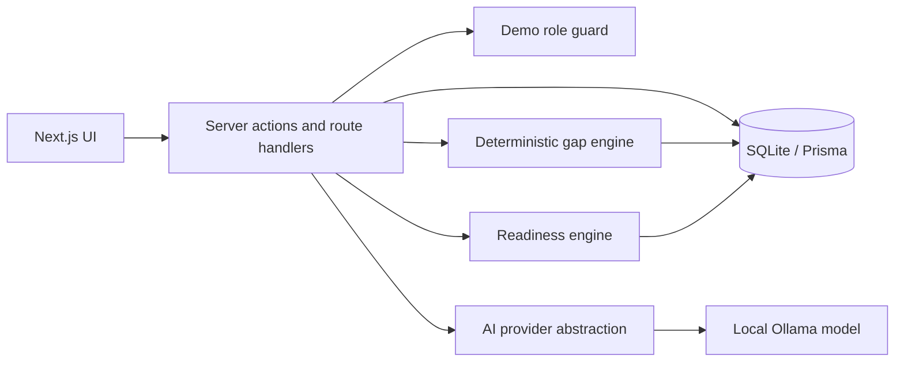

# Architecture

The modular monolith keeps server-side business rules outside React components. Prisma parameterizes database access. Demo role state is stored in HTTP-only cookies; all mutations require server-side Zod validation.
